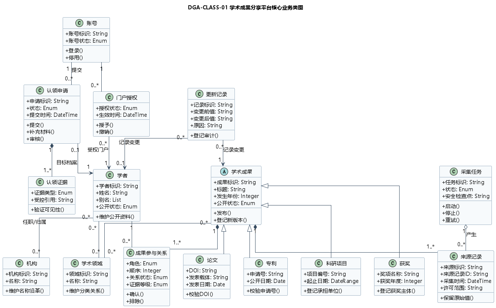
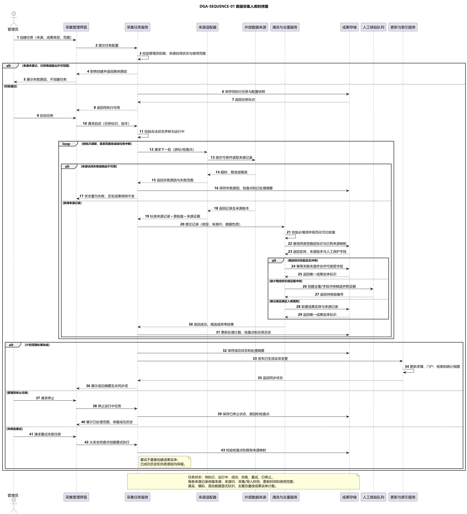
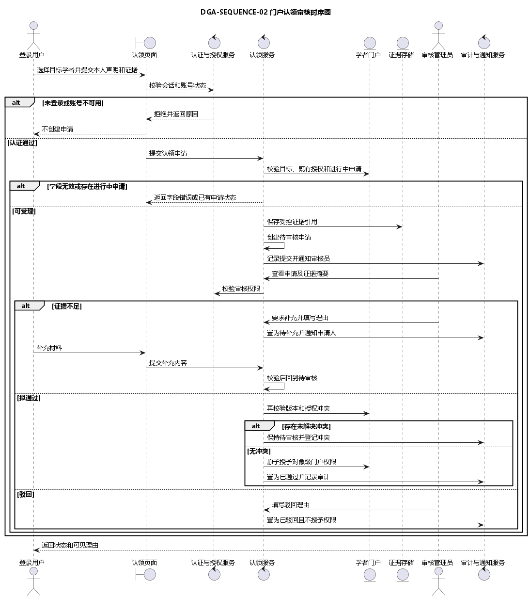
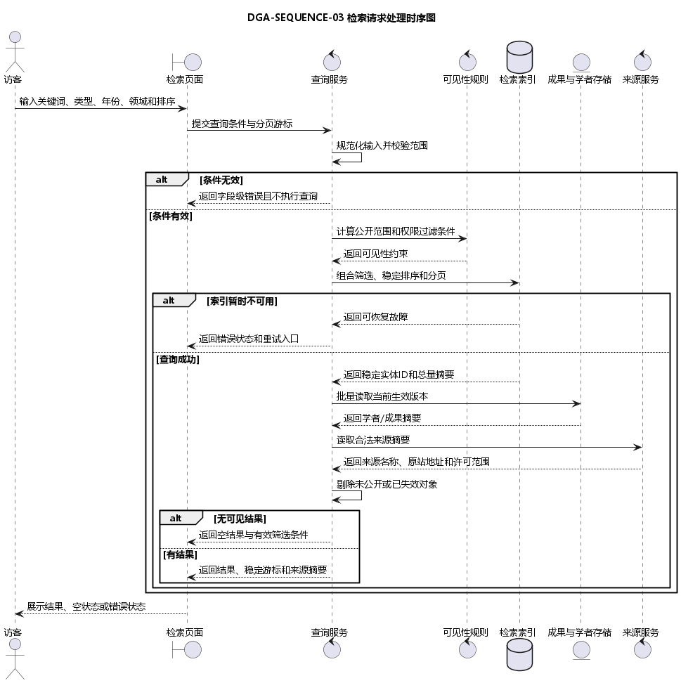

# 学术成果分享平台需求分析报告

> 课程：《软件系统分析与设计》　作业：作业 3 需求分析　团队：03组 可御风雪可燃冰　子组：CognitaNexus 与 OvO　版本：V1.0　日期：2026年10月24日

## 1 报告结论与范围

本报告把已确认的需求基线转化为可核查的分析模型。当前模型以学者为中心，覆盖论文、专利、科研项目和获奖四类成果；以来源记录和成果参与关系保留可追溯证据；以认领申请和门户授权分离“申请状态”与“对象级管理权”；以采集任务、更新记录支撑失败恢复与审计。核心业务类图和三张关键时序图与 FR01～FR16、IN01 及适用的 NF01～NF08 保持对应，不提前规定数据库表、接口地址或技术框架。

本阶段交付范围包括业务对象清单、核心业务类图、数据采集入库、门户认领审核、检索请求处理三张时序图、模型一致性说明和质量检查。推荐功能、论文全文、付费数据库采集、自动转移既有门户授权、跨类型自动合并成果不在当前模型承诺内。

## 2 分析依据与方法

### 2.1 输入依据

|输入|用途|效力边界|
|---|---|---|
|课程作业 3 展示与提交要求|确定必须交付的业务对象、类图、三张时序图和 Word 报告|课程硬性要求优先|
|共同需求基线 V1.9|确定 FR01～FR16、IN01、NF01～NF08 的范围和优先级|不在分析阶段改写父需求语义|
|共同 SRS V1.1 Implementation RC|细化角色、状态、异常和验收口径|Review Candidate，待双组签认|
|OvO SRS V0.4 与核心规则 SPEC|核对采集、去重、消歧、检索和权限规则|作为可追溯细化输入|
|既有用例图、活动图和状态图|检查参与者、流程和状态的一致性|图文冲突时登记修改，不默选规则|

### 2.2 分析步骤

1. 从需求名词、状态对象和审计对象中识别候选业务对象。
2. 合并同义对象，分离账号、学者档案、认领申请、门户授权、成果实体和来源记录。
3. 为每个对象确定稳定标识、关键业务属性、状态和领域操作。
4. 使用继承表达四类成果的共同语义，使用组合表达离开主对象即失去独立业务意义的记录。
5. 按用例主成功流程和异常闭环建立时序图，逐项回查 SRS、状态图及权限规则。

## 3 核心业务对象清单

|编号|业务对象|核心职责|关键状态或属性|需求来源|
|---|---|---|---|---|
|BO-01|账号|保存登录身份和账号有效性，不等同于学者档案|账号标识、账号状态、角色|FR04、NF03|
|BO-02|学者|承载公开身份、机构、领域和成果关系|学者标识、姓名、别名、公开状态|FR03、FR15|
|BO-03|学术成果|四类成果的抽象父类，承载共同元数据和生效版本|成果标识、标题、年份、公开状态|FR02、FR16|
|BO-04|论文|保存 DOI、发表载体和发表日期；作者顺序由成果参与关系记录|DOI、发表载体、发表日期|FR02、FR12、FR16|
|BO-05|专利|保存申请号、发明人和公开日期|申请号、申请/公开日期|FR02、FR16|
|BO-06|科研项目|保存项目编号、负责人和承担单位|项目编号、起止日期|FR02、FR16|
|BO-07|获奖|保存奖项、年度和获奖主体|奖项名称、获奖年度|FR02、FR16|
|BO-08|成果参与关系|连接学者与成果，保留角色、顺序、证据和关系状态|自动关联、本人确认、待核验、争议、已排除|FR07、FR15|
|BO-09|机构|统一机构身份、名称沿革和任职关联|机构标识、名称|FR03、FR11|
|BO-10|学术领域|支撑分类、筛选、统计和热点|领域标识、名称、父子关系|FR01、FR11、FR13|
|BO-11|来源记录|保存来源ID、原始值、许可和时间，支持追溯|来源记录ID、采集时间、许可范围|FR08、FR16、NF07|
|BO-12|认领申请|保存申请、补充、审核和终态|待审核、待补充、已通过、已驳回、争议|FR05|
|BO-13|认领证据|保存受控证据引用及可见性|证据类型、受控引用|FR05、NF06|
|BO-14|门户授权|表达账号对特定学者门户的对象级管理权|授权状态、生效时间|FR04～FR07|
|BO-15|采集任务|管理来源采集、检查点、失败和恢复|待执行、运行中、成功、失败、重试、已停止|FR08、FR10|
|BO-16|更新记录|保存字段前后值、原因和操作者|记录标识、对象、前后值、原因|FR10、FR14|

对象边界的关键结论是：账号不自动生成学者身份；姓名相同不构成同一学者证据；采集成功不等于治理通过；认领申请通过只授予目标门户权限，不代表该学者名下全部成果均已本人确认。

## 4 核心业务类图

### 4.1 继承与组合决策

论文、专利、科研项目和获奖继承学术成果，共享成果标识、标题、年份和公开状态，同时保留各自的专属字段。该结构避免把四类成果压成包含大量空字段的单一对象，也不把每种成果拆成彼此无关的重复模型。

学术成果与来源记录、成果参与关系采用组合：来源证据和参与关系必须依附具体成果，但删除一名学者的关系不得删除成果实体及其他参与者关系。认领申请与认领证据采用组合；账号与门户授权、学者与机构/领域采用关联。采集任务与来源记录采用聚合，表示任务可产生多条来源记录，而来源记录在任务结束后仍作为追溯证据保留。

### 4.2 属性和方法边界

类图中的方法表达业务责任，例如“审核、授予、撤销、启动、停止、重试、登记新版本”，不是接口签名。数据类型用于澄清字段意义，不等价于数据库类型。公开状态、关系状态和任务状态必须使用 SRS 已定义的枚举，不允许由实现人员另造同义状态。

## 5 数据采集入库交互模型

管理员在来源已登记、启用且许可范围匹配时创建和启动任务。采集服务按安全检查点分批读取，来源适配器保留来源ID、原始值和来源证据；清洗去重服务先完成字段规范化，再按稳定标识及规则生成唯一实体、候选或新实体。证据不足或冲突项进入人工核验队列，不能直接自动合并。批次成功后更新检查点并传播生效结果；来源失败、人工停止和恢复重试均保留已成功数据及审计历史。

|项目|说明|
|---|---|
|参与者|管理员、采集管理界面、采集任务服务、来源适配器、外部数据来源、清洗与去重服务、成果存储、人工核验队列、更新与索引服务|
|前置条件|来源获准且启用；管理员具有具体管理权限；任务配置通过校验|
|主要结果|成果/候选和来源记录入库；任务状态、检查点、摘要与失败范围可查询|
|异常闭环|越界拒绝、来源超时/限流、冲突转人工、停止保留历史、从安全检查点幂等重试|
|追踪|FR08～FR10、FR15～FR16；UC-09/UC-10；NF04、NF05、NF07|

## 6 门户认领审核交互模型

认领流程先校验会话、账号、目标档案和已有进行中申请；材料受理后只保存受控证据引用。审核员可要求补充、通过或驳回。证据不足时申请进入待补充并在补充校验后回到待审核；存在未解决授权冲突时保持待审核，不覆盖既有授权。无冲突且最终权限、版本校验通过时，申请通过与对象级门户授权在同一成功结果中完成并记录审计。

|项目|说明|
|---|---|
|参与者|登录用户、认领页面、认证与授权服务、认领服务、学者门户、证据存储、审核管理员、审计与通知服务|
|前置条件|账号有效；目标学者档案存在；用户提交本人声明和必要证据|
|主要结果|申请状态可跟踪；通过时授予目标门户权限；驳回或冲突不改变既有授权|
|异常闭环|未登录、字段无效、重复申请、证据不足、版本变化、竞争认领冲突|
|追踪|FR04～FR05、FR14（本流程）；FR06～FR07（授权后的下游能力）；UC-05/UC-06；NF03、NF05、NF06|

## 7 检索请求处理交互模型

检索服务规范化关键词、类型、年份、领域、排序和分页游标，随后应用公开范围与权限过滤。索引只返回稳定实体ID，实体存储提供当前生效版本，来源服务提供合法来源摘要。系统必须区分条件错误、索引故障、空结果和有结果四种可观察状态；稳定排序在并列字段后使用稳定实体ID打破并列，翻页保留查询上下文。

|项目|说明|
|---|---|
|参与者|访客、检索页面、查询服务、可见性规则、检索索引、成果与学者存储、来源服务|
|前置条件|无需登录；输入可以为空关键词但必须符合字段范围和组合规则|
|主要结果|返回公开有效的学者/成果摘要、稳定分页游标和来源摘要|
|异常闭环|字段级校验失败不执行查询；索引故障给出重试入口；无结果不伪装为错误|
|追踪|FR01～FR03；UC-01～UC-03；NF01～NF03、NF05|

## 8 分析模型一致性

|分析元素|SRS/用例|既有模型|一致性判定|
|---|---|---|---|
|账号、学者、门户授权分离|FR03～FR07|总体用例图、认领活动图、认领状态图|一致；避免“注册即成为学者”|
|四类成果继承学术成果|FR02、FR16|成果治理局部用例图|一致；共性集中、专属字段保留|
|成果参与关系独立建模|FR07、FR12、FR15|治理与身份消歧图|一致；关系状态不污染成果实体|
|采集任务六状态|FR08、FR10|数据采集任务状态图|一致；禁止失败直接跳成功|
|认领申请状态与门户公开状态分离|FR05|认领活动图、认领申请状态图|一致；竞争申请不自动转移授权|
|稳定分页和公开过滤|FR01|总体用例图|一致；时序图补齐查询内部协作|
|来源记录和更新记录|FR10、FR14、FR16|采集治理用例图|一致；支持前后值、原因和来源追踪|

## 9 非功能与合规约束

- 公开检索、门户和统计无需登录，但只返回当前公开生效数据。
- 每次受保护写操作同时校验会话、账号状态、操作能力、对象级授权和对象版本。
- 采集失败不得破坏已成功历史；重试从安全检查点恢复并保持幂等。
- 认领证据只对申请人和有权审核者可见；不在公开页面或普通日志中暴露。
- 真实、模拟和混合数据必须明确标识；不得爬取个人隐私、收费数据库或未授权内容。
- 模型中的服务名称用于职责分解，不构成微服务数量、接口或部署架构承诺。

## 10 质量检查与待完成事项

文本与 PlantUML 图源已完成静态核对，核心类图与三张时序图均通过 PlantUML 语法渲染。数据采集入库图已有 CodeArts 导入候选包；核心类图、认领审核和检索处理仍须在 CodeArts Modeling 中导入或重绘、人工精修并重新导出。最终提交前还需由各模型负责人逐图签认，补齐两小组全体成员的实际 AI 使用记录与签名；课堂展示后将教师及互评意见写入修改说明与版本记录表。

## 附录 A 分工与签认

|工作|主责|协作/复核|当前状态|
|---|---|---|---|
|业务对象识别与报告统稿|高昕宇|宋显涵|对象清单与报告底稿完成，待联合签认|
|核心业务类图|王昊涵|高昕宇|底稿完成，待 CodeArts 精修|
|数据采集入库时序图|宋显涵|王昊涵|底稿及候选包完成，待平台验证|
|门户认领审核时序图|李昊阳|王昊涵|底稿完成，待 CodeArts 精修|
|检索请求处理时序图与展示整合|孙子涵|高昕宇|底稿完成，待 CodeArts 精修|
|AI 声明与一致性追踪|宋显涵|全员|V1.0 已形成，待收齐实际记录并联合签认|

