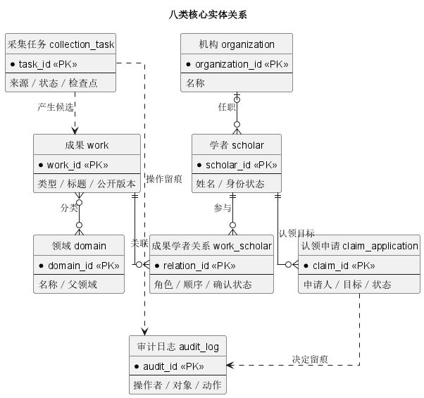
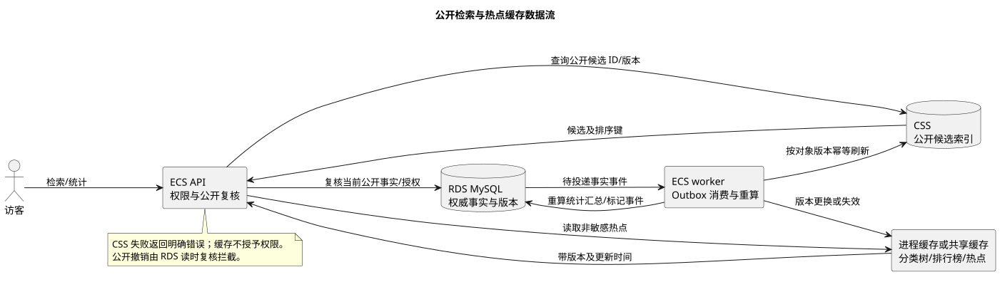

# 学术成果分享平台数据库设计说明书

03组 可御风雪可燃冰｜作业5构件设计｜V0.2 初稿｜2026-11-18

编写：宋显涵委托 Codex 辅助起草，尚未与其他成员的作业5成果比对；两小组成员、具体分工和签认待团队据实填写。本文面向课程评审与后续实现人员，给出可核对的概念模型、字段约束、索引和缓存规则。它是参考设计，未声称数据库、CSS 或缓存已部署。

## 1 设计依据与边界

依据共同需求 V1.9、OvO SRS V0.4 的 FR01—FR16/IN01、`data-and-rules.md`、核心规则 SPEC 初稿，以及架构 ADR-01—04。RDS MySQL 保存业务事实、授权、任务、审计和 Outbox；OBS 保存原始批次与受控证明；CSS 只承载已公开候选检索文档。最终清洗去重成果目标为不少于 1 万条，属于需求目标，并非当前实测。

本设计不存密码明文、认领证明原文、未获准来源内容或收费数据库数据。受控证明的对象键只在认领申请中保存，OBS 对象访问须由审核权限校验。来源采集失败不等同于成果撤稿。

## 2 概念模型与实体关系

图1展示八类核心实体及主要关系。

图1 E-R 核心概念模型。该图的 `.puml` 为同名源文件；包含支撑表的全量模型为 `03-ER图-可御风雪可燃冰.puml/.svg`，DDL 为 `02-核心表DDL-可御风雪可燃冰.sql`。

`学术成果`按 `work_type` 区分论文、专利、科研项目、获奖，公共字段放 `work`，专属字段按版本化 JSON 保存；四类扩展字段模式见 `06-四类成果扩展字段Schema-可御风雪可燃冰.json`。进入实现前需用四类样本验证模式，并将高频过滤字段提升为独立列。`来源记录`与`学术成果`分离，使多来源合并仍可追溯；未归并记录的 `work_id` 可空。`学者`与`成果`通过有角色和确认状态的关系表关联，不用姓名相同直接合并。

表1列出实体、主键、重要约束与需求对应。完整列类型、外键、检查约束和索引以同版 DDL 为准。

|实体与表|关键字段及约束|关系与需求|
|---|---|---|
|学者 `scholar`|`scholar_id` 主键；姓名非空；身份/公开状态、数据性质及版本受控|可选任职机构；FR03、FR15|
|机构 `organization`|稳定主键、名称及规范化名称；名称不直接作全局唯一身份|一机构可关联多学者；FR11、FR15|
|成果 `work`|类型、标题、公开状态、数据性质、版本非空；四类类型受检查约束|一成果有多关系、领域和来源；FR02、FR09、FR16|
|成果学者 `work_scholar`|成果、学者、角色组合唯一；顺序为正；确认状态受控|关联证据与发生时机构；FR07、FR12、FR15|
|领域 `domain`|自关联父领域；同级名称唯一；排序和启用标志|成果领域通过 `work_domain` 关联；FR01、FR11|
|认领申请 `claim_application`|申请人、目标、声明、证据对象键、状态、版本；审核人可空|批准后单独生成 `portal_grant`；FR05|
|采集任务 `collection_task`|来源、方式、参数、状态、检查点、计数、租约及版本|只使用已核准来源；FR08、FR10|
|审计日志 `audit_log`|操作者、动作、对象、结果、原因、时间和关联号|不含凭据和证明原文；FR14、NF03|
|支撑表|`account`、`account_capability`、`portal_grant`、`data_source`、`source_record`、`source_record_history`、`work_domain`、`scholar_domain`、`outbox_event`|登录授权、管理员细分能力、来源版本追踪、成果/学者分类、异步一致性|

### 2.1 四类成果字段

表2是 `type_details` 的逻辑模式，不表示所有字段均必填。来源未给出的值保持缺失；真实/模拟/混合由 `data_nature` 显式区分。

|类型|专属字段与约束|稳定标识判重|
|---|---|---|
|论文|DOI、载体、摘要、关键词、发表日期及精度、发表状态、作者顺序；引用量按来源保存|有 DOI 时规范化比较；无 DOI 仅建候选|
|专利|国家地区、申请号、公开号、申请人、发明人、申请/公开/授权日、IPC、状态来源日期|按国家地区与申请号作用域比较|
|科研项目|来源域、项目编号、负责人、承担单位、类别、起止时间及状态|按来源或资助机构作用域比较|
|获奖|奖项名称、年度、等级、授奖单位、获奖成果、人员或团队|无通用号码时只生成候选，不自动合并|

日期同时保留精度；只有年份时不得补造月日。`identifier_norm` 保留规范值，原始标识由来源记录保留。人工审核值不因来源更新时间较新而被覆盖。JSON Schema 已给出结构与类型，但跨字段的日期先后、标识作用域和来源证据仍须按 SPEC 在业务层校验。

### 2.2 生命周期与一致性

认领状态为 `pending_review → needs_more → pending_review → approved/rejected`，已有门户管理者冲突时禁止批准。批准、门户授权和成功审计须处于同一 RDS 事务；失败回滚时不得显示成功。采集状态为 `pending/running/succeeded/failed/stopped/retrying`，worker 以租约领任务，停止和失败保留检查点、原始批次及已成功事实。成果事实与 Outbox 事件同事务提交；CSS 和统计按对象版本消费，旧事件不得覆盖新版本。

## 3 物理表与索引设计

DDL 目标为 MySQL 8.0.16+，使用 InnoDB、`utf8mb4`、应用生成 ULID 主键和 UTC 时间；较早 8.0 版本不会执行本稿依赖的 `CHECK` 约束。表3记录主要访问路径；索引字段顺序对应“等值过滤在前、范围/排序在后”，是否命中仍需后续 EXPLAIN 与数据量验证。

|访问路径|索引或约束|设计理由|
|---|---|---|
|公开成果浏览|`work(public_status,work_type,publication_year,work_id)`|状态与类型筛选、年份范围、稳定次序|
|来源幂等|`source_record(source_id,external_id)` 唯一|重复采集不复制来源记录|
|作者门户|`work_scholar(scholar_id,confirmation_status,work_id)`|只取可公开的已确认或自动关联关系|
|认领审核队列|`claim_application(state,submitted_at,claim_id)`|状态筛选和稳定分页|
|采集待办|`collection_task(state,lease_until,created_at)`|恢复过期租约与排队|
|审计检索|`audit_log(object_type,object_id,happened_at)` 与操作者时间索引|按对象或人员追踪|
|事件投递|`outbox_event(state,available_at,created_at)`|扫描待投递事件|

机构同名可能不同实体，不能对规范化名称加无作用域全局唯一约束。`domain(parent_id,name)` 约束非根领域的同级重名；根领域因 `parent_id` 可空，须由写入服务另作同名检查。`portal_grant(account_id,scholar_id)` 唯一只限制同一人对同一门户的重复授权；是否允许多个管理人由审核规则决定，不能用数据库唯一键暗中改写业务规则。

## 4 CSS 检索索引设计

索引名 `public_work_v1` 和 `public_scholar_v1` 是逻辑别名；重建时写新物理索引并原子切换别名。仅投递 `public_status=public` 且来源许可允许公开的字段。证明、审计、账号信息、内部冲突候选、未生效修改不得入索引。CSS 返回候选 ID、版本与排序键，API 再对 RDS 当前公开状态、版本、授权做复核；复核失败的候选不返回。索引服务失败返回明确错误，不能伪装为空结果。

图2展示权威事实、公开候选与热点缓存之间的数据流；成果和学者的索引映射设计文件分别为 `04-CSS公开索引映射-可御风雪可燃冰.json`、`04-CSS学者索引映射-可御风雪可燃冰.json`。

图2 检索索引与缓存数据流。

表4为成果索引字段映射。学者索引复用 ID、版本、公开状态、名称/别名、公开机构与领域字段，检索范围必须显式区分成果/学者。

|字段|映射|用途|
|---|---|---|
|`work_id`,`version`,`work_type`,`data_nature`|keyword / long|候选复核、类型与性质筛选|
|`title`,`abstract`,`keywords`|text，中文分词与英文小写归一；另设 keyword 子字段|全文检索与精确排序|
|`publication_year`|integer|双端包含的年份筛选与年份分面|
|`domain_ids`,`organization_ids`|keyword|领域含下级展开、机构过滤和分面|
|`sort_time`,`work_id`|date / keyword|稳定排序与续页游标|
|`source_public`|boolean|只允许公开候选入索引|

中文采用已验证的分词器配置；若目标 CSS 环境未提供所选插件，回退为内置标准分词并在部署验证中记录差异。拉丁词统一小写，DOI 等稳定标识走 keyword 精确匹配；词典与同义词须版本化，不能默默改变旧搜索结果。分面配置为 `work_type`、`publication_year`、`domain_ids`、`organization_ids`、`data_nature`；各维度先在当前查询范围内聚合，计数口径显示“成果实体去重”。深分页使用绑定查询摘要和排序键的 `search_after` 风格游标；游标失效提示重新查询，不返回错页。排序先匹配度，次公开时间（缺失排后），末尾以 `work_id` 稳定决胜；具体权重在样例集上调校，未宣称已完成相关性评测。

## 5 缓存设计

首期可用 API 进程内有界缓存；多实例部署前改为共享缓存或直接以 RDS 汇总表读取，不能让各实例数据长期不一致。缓存不是权威数据源，不能缓存认领证明或管理员敏感响应。

|缓存键|内容与建议 TTL|失效规则与降级|
|---|---|---|
|`domain-tree:v{taxonomy_version}`|公开分类树，10 分钟|分类事务提交后更新版本；失效时从 RDS 读取|
|`ranking:{scope}:{filterHash}:v{summary_version}`|公开机构排行榜，5 分钟|统计重算版本变化后换键；页面显示汇总时间|
|`hotspot:{domain}:{window}:v{summary_version}`|公开热点，5 分钟|事件重算后换键；样本不足不缓存“结论”|
|`work-detail:{id}:v{version}`|仅公开详情短期缓存，1 分钟|查询前仍复核当前公开状态；撤销时立即失效|

缓存键的筛选摘要规范化，防止等价条件产生无限键；设条目上限和过期淘汰。公开撤销、门户授权、认领审核不依赖 TTL 保证即时安全，读时检查 RDS。缓存或 CSS 故障时分别降级：分类树/排行榜可回主库，公开检索不可用须报错。

## 6 数据保护、迁移与验证

证明只存 OBS 受控对象键，审核接口按申请人或相应审核员判权；日志摘要删除证明原文、密码和令牌。审计记录只追加，错误更正另写事件。保留期和删除策略须由负责人签认；本稿不自行指定真实材料保留时长。

DDL 检查目标：可在 MySQL 8.0.16+ 空库依序建表；导入合成数据后验证外键、唯一键、状态约束、重复来源幂等；模拟审批事务回滚、事件重复/倒序、来源超时、CSS 旧版本及缓存失效。性能目标按已批准 NF 基线进行未来压测，本稿不声称测试通过。待联合评审项：类型 JSON 模式、身份稳定标识的唯一作用域、部署分词器、缓存实现选型与两组方案比较。

## 7 标准与参考

1. [MySQL 8.0 CREATE TABLE 官方说明](https://dev.mysql.com/doc/refman/8.0/en/create-table.html)：表、索引与外键语法。
2. [MySQL 8.0 CHECK 约束官方说明](https://dev.mysql.com/doc/refman/8.0/en/create-table-check-constraints.html)：8.0.16 起执行 CHECK 约束。
3. 本仓库 `docs/srs/data-and-rules.md`、`docs/spec/` 与 `docs/architecture/05-架构决策记录ADR-可御风雪可燃冰.md`：业务字段、规则与架构依据。

<!-- DATA DICTIONARY START -->
## 附录 A 八类核心表字段字典

本附录逐列列出类型、空值与主要约束；完整可执行语法和支撑表见同版 DDL。`PK` 为主键，`FK` 为外键；`CHECK` 约束在目标 MySQL 8.0.16+ 执行。索引条目给出字段顺序，后续需在目标数据量下用 EXPLAIN 验证。

### A.1 学者 `scholar`

表 5 学者表字段设计

|字段|类型|空值与约束|语义|
|---|---|---|---|
|`scholar_id`|`CHAR(26)`|非空；PK|平台学者稳定标识|
|`display_name`|`VARCHAR(200)`|非空|公开姓名|
|`aliases_json`|`JSON`|可空|公开别名集合|
|`organization_id`|`CHAR(26)`|可空；FK→organization.organization_id|机构稳定标识|
|`biography`|`TEXT`|可空|公开简介|
|`identity_status`|`VARCHAR(20)`|非空；默认 'candidate'|身份判定状态|
|`public_status`|`VARCHAR(16)`|非空；默认 'public'|当前公开资格|
|`data_nature`|`VARCHAR(16)`|非空；默认 'real'|真实、模拟或混合|
|`version`|`BIGINT`|非空；默认 1|对象乐观锁版本|
|`created_at`|`DATETIME(3)`|非空|创建时间（UTC）|
|`updated_at`|`DATETIME(3)`|非空|更新或检查时间（UTC）|

**索引。** 普通 `ix_scholar_org_public`：organization_id, public_status；普通 `ix_scholar_name`：display_name

**检查约束。** `ck_scholar_identity`：`identity_status IN ('candidate','verified','disputed')`；`ck_scholar_public`：`public_status IN ('public','hidden')`；`ck_scholar_nature`：`data_nature IN ('real','simulated','mixed')`

### A.2 机构 `organization`

表 6 机构表字段设计

|字段|类型|空值与约束|语义|
|---|---|---|---|
|`organization_id`|`CHAR(26)`|非空；PK|机构稳定标识|
|`name`|`VARCHAR(300)`|非空|名称|
|`normalized_name`|`VARCHAR(300)`|非空|用于候选匹配的规范名称|
|`source_scope`|`VARCHAR(100)`|可空|名称适用来源或作用域|
|`public_status`|`VARCHAR(16)`|非空；默认 'public'|当前公开资格|
|`created_at`|`DATETIME(3)`|非空|创建时间（UTC）|

**索引。** 普通 `ix_org_name`：normalized_name

**检查约束。** `ck_org_public`：`public_status IN ('public','hidden')`

### A.3 学术成果 `work`

表 7 学术成果表字段设计

|字段|类型|空值与约束|语义|
|---|---|---|---|
|`work_id`|`CHAR(26)`|非空；PK|成果实体稳定标识|
|`work_type`|`VARCHAR(16)`|非空|论文、专利、项目或获奖|
|`title`|`VARCHAR(1000)`|非空|成果标题|
|`abstract_text`|`TEXT`|可空|公开摘要|
|`publication_year`|`SMALLINT`|可空|按类型定义的筛选年份|
|`date_precision`|`VARCHAR(8)`|可空|来源日期精度|
|`identifier_kind`|`VARCHAR(32)`|可空|稳定标识类别|
|`identifier_scope`|`VARCHAR(100)`|可空|标识命名空间|
|`identifier_norm`|`VARCHAR(300)`|可空|规范化标识|
|`type_details`|`JSON`|非空|按成果类型校验的扩展字段|
|`public_status`|`VARCHAR(16)`|非空；默认 'candidate'|当前公开资格|
|`data_nature`|`VARCHAR(16)`|非空|真实、模拟或混合|
|`version`|`BIGINT`|非空；默认 1|对象乐观锁版本|
|`created_at`|`DATETIME(3)`|非空|创建时间（UTC）|
|`updated_at`|`DATETIME(3)`|非空|更新或检查时间（UTC）|

**索引。** 普通 `ix_work_browse`：public_status, work_type, publication_year, work_id；普通 `ix_work_identifier`：identifier_kind, identifier_scope, identifier_norm

**检查约束。** `ck_work_type`：`work_type IN ('paper','patent','project','award')`；`ck_work_public`：`public_status IN ('candidate','public','withdrawn','hidden')`；`ck_work_nature`：`data_nature IN ('real','simulated','mixed')`；`ck_work_precision`：`date_precision IS NULL OR date_precision IN ('year','month','day')`；`ck_work_year`：`publication_year IS NULL OR publication_year BETWEEN 1000 AND 9999`

### A.4 成果学者关系 `work_scholar`

表 8 成果学者关系表字段设计

|字段|类型|空值与约束|语义|
|---|---|---|---|
|`relation_id`|`CHAR(26)`|非空；PK|关系稳定标识|
|`work_id`|`CHAR(26)`|非空；FK→work.work_id；唯一键成员|成果实体稳定标识|
|`scholar_id`|`CHAR(26)`|非空；FK→scholar.scholar_id；唯一键成员|平台学者稳定标识|
|`role_code`|`VARCHAR(40)`|非空；唯一键成员|参与角色|
|`author_order`|`INT`|可空|作者或参与者顺序|
|`organization_at_work_id`|`CHAR(26)`|可空；FK→organization.organization_id|成果发生时机构|
|`confirmation_status`|`VARCHAR(24)`|非空|归属确认与争议状态|
|`evidence_record_id`|`CHAR(26)`|可空；FK→source_record.record_id（后置 ALTER）|归属证据来源记录|
|`version`|`BIGINT`|非空；默认 1|对象乐观锁版本|
|`created_at`|`DATETIME(3)`|非空|创建时间（UTC）|

**索引。** 唯一 `uk_work_scholar_role`：work_id, scholar_id, role_code；普通 `ix_ws_scholar`：scholar_id, confirmation_status, work_id

**检查约束。** `ck_ws_status`：`confirmation_status IN ('auto_linked','self_confirmed','pending','disputed','excluded')`；`ck_ws_order`：`author_order IS NULL OR author_order > 0`

### A.5 领域 `domain`

表 9 领域表字段设计

|字段|类型|空值与约束|语义|
|---|---|---|---|
|`domain_id`|`CHAR(26)`|非空；PK|领域稳定标识|
|`parent_id`|`CHAR(26)`|可空；FK→domain.domain_id；唯一键成员|父领域；根领域为空|
|`name`|`VARCHAR(200)`|非空；唯一键成员|名称|
|`sort_order`|`INT`|非空；默认 0|同级展示顺序|
|`active`|`BOOLEAN`|非空；默认 TRUE|是否启用|

**索引。** 唯一 `uk_domain_sibling`：parent_id, name；普通 `ix_domain_parent`：parent_id, sort_order

### A.6 认领申请 `claim_application`

表 10 认领申请表字段设计

|字段|类型|空值与约束|语义|
|---|---|---|---|
|`claim_id`|`CHAR(26)`|非空；PK|申请稳定标识|
|`applicant_account_id`|`CHAR(26)`|非空；FK→account.account_id|申请人账号|
|`target_scholar_id`|`CHAR(26)`|非空；FK→scholar.scholar_id|目标学者档案|
|`declaration_text`|`VARCHAR(1000)`|非空|本人声明|
|`evidence_object_keys`|`JSON`|非空|受控证明 OBS 对象引用|
|`state`|`VARCHAR(20)`|非空；默认 'pending_review'|业务状态|
|`review_reason`|`VARCHAR(1000)`|可空|审核决定或补充原因|
|`reviewer_account_id`|`CHAR(26)`|可空；FK→account.account_id|审核员账号|
|`version`|`BIGINT`|非空；默认 1|对象乐观锁版本|
|`submitted_at`|`DATETIME(3)`|非空|申请提交时间（UTC）|
|`decided_at`|`DATETIME(3)`|可空|最终决定时间（UTC）|

**索引。** 普通 `ix_claim_queue`：state, submitted_at, claim_id；普通 `ix_claim_applicant`：applicant_account_id, submitted_at；普通 `ix_claim_target`：target_scholar_id, state

**检查约束。** `ck_claim_state`：`state IN ('pending_review','needs_more','approved','rejected')`

### A.7 采集任务 `collection_task`

表 11 采集任务表字段设计

|字段|类型|空值与约束|语义|
|---|---|---|---|
|`task_id`|`CHAR(26)`|非空；PK|采集任务稳定标识|
|`source_id`|`CHAR(26)`|非空；FK→data_source.source_id|获准数据来源|
|`created_by`|`CHAR(26)`|非空；FK→account.account_id|任务创建人|
|`mode_code`|`VARCHAR(16)`|非空|增量或全量方式|
|`parameters_json`|`JSON`|非空|受控采集参数摘要|
|`state`|`VARCHAR(16)`|非空；默认 'pending'|业务状态|
|`checkpoint_json`|`JSON`|可空|可恢复检查点|
|`processed_count`|`BIGINT`|非空；默认 0|已处理记录数|
|`success_count`|`BIGINT`|非空；默认 0|成功记录数|
|`failure_count`|`BIGINT`|非空；默认 0|失败记录数|
|`retry_count`|`INT`|非空；默认 0|重试次数|
|`failure_reason`|`VARCHAR(1000)`|可空|最近失败原因|
|`lease_owner`|`VARCHAR(100)`|可空|当前 worker 租约持有者|
|`lease_until`|`DATETIME(3)`|可空|租约截止时间（UTC）|
|`created_at`|`DATETIME(3)`|非空|创建时间（UTC）|
|`started_at`|`DATETIME(3)`|可空|最近开始时间（UTC）|
|`ended_at`|`DATETIME(3)`|可空|结束时间（UTC）|
|`version`|`BIGINT`|非空；默认 1|对象乐观锁版本|

**索引。** 普通 `ix_task_queue`：state, lease_until, created_at；普通 `ix_task_source`：source_id, created_at

**检查约束。** `ck_task_state`：`state IN ('pending','running','succeeded','failed','stopped','retrying')`；`ck_task_counts`：`processed_count >= 0 AND success_count >= 0 AND failure_count >= 0 AND retry_count >= 0`

### A.8 审计日志 `audit_log`

表 12 审计日志表字段设计

|字段|类型|空值与约束|语义|
|---|---|---|---|
|`audit_id`|`CHAR(26)`|非空；PK|审计事件稳定标识|
|`actor_account_id`|`CHAR(26)`|可空；FK→account.account_id|操作者账号；系统事件可空|
|`action_code`|`VARCHAR(80)`|非空|操作类别|
|`object_type`|`VARCHAR(40)`|非空|目标对象类别|
|`object_id`|`CHAR(26)`|非空|目标对象标识|
|`before_summary`|`JSON`|可空|变更前最小摘要（脱敏）|
|`after_summary`|`JSON`|可空|变更后最小摘要（脱敏）|
|`reason`|`VARCHAR(1000)`|可空|操作原因|
|`outcome`|`VARCHAR(16)`|非空|成功、拒绝或失败|
|`happened_at`|`DATETIME(3)`|非空|发生时间（UTC）|
|`correlation_id`|`CHAR(26)`|可空|跨步骤关联号|

**索引。** 普通 `ix_audit_object`：object_type, object_id, happened_at；普通 `ix_audit_actor`：actor_account_id, happened_at

**检查约束。** `ck_audit_outcome`：`outcome IN ('success','rejected','failed')`
<!-- DATA DICTIONARY END -->
