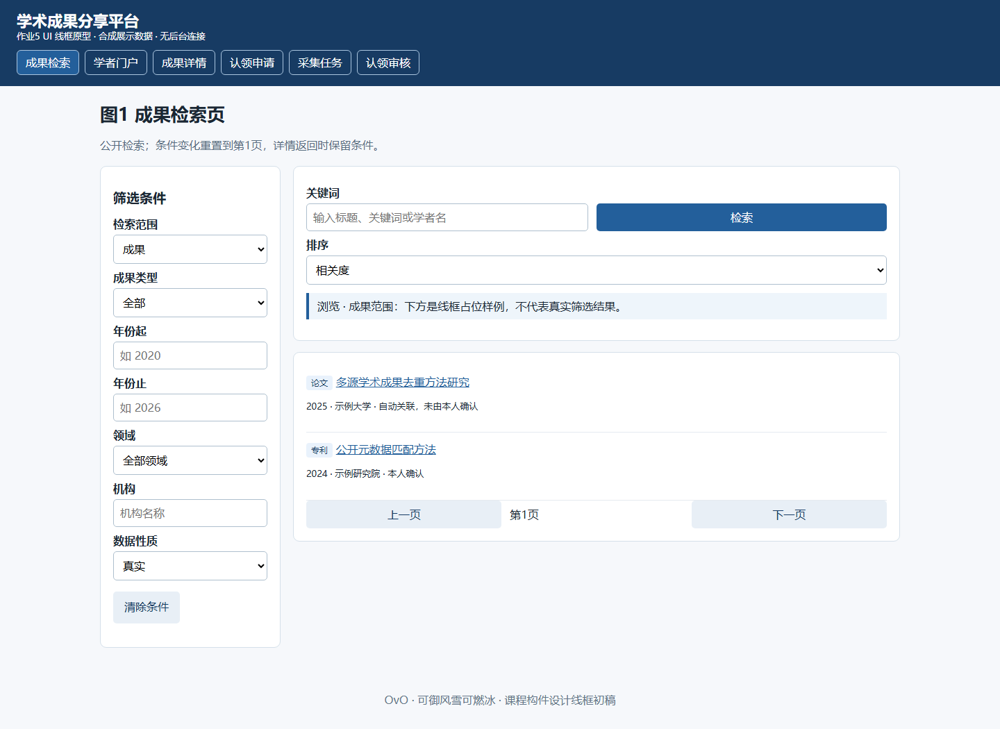
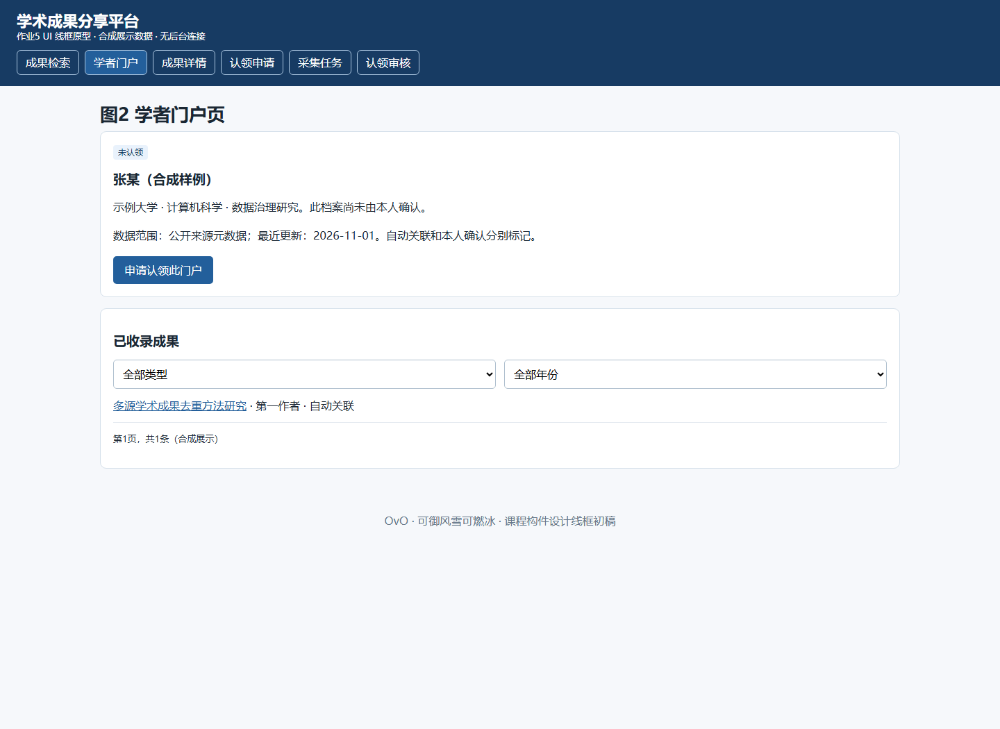
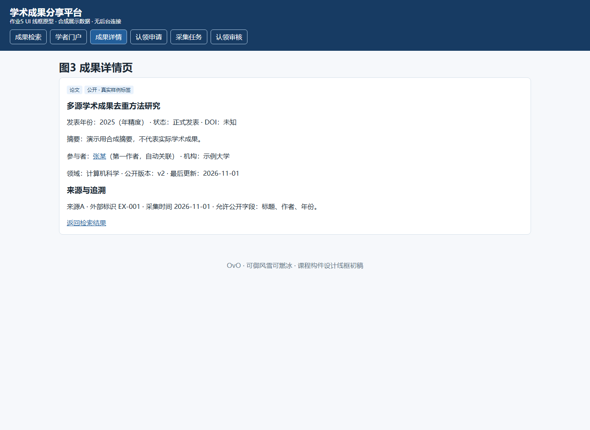
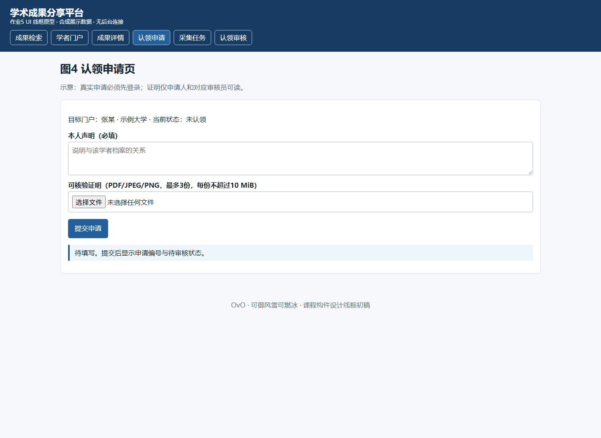
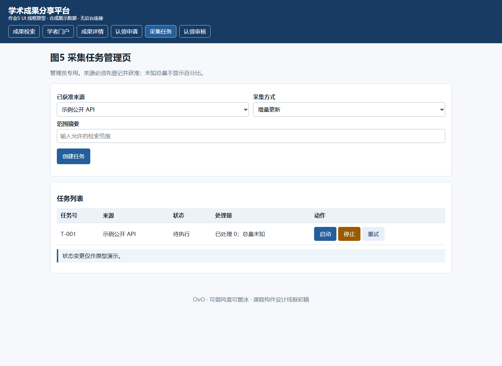
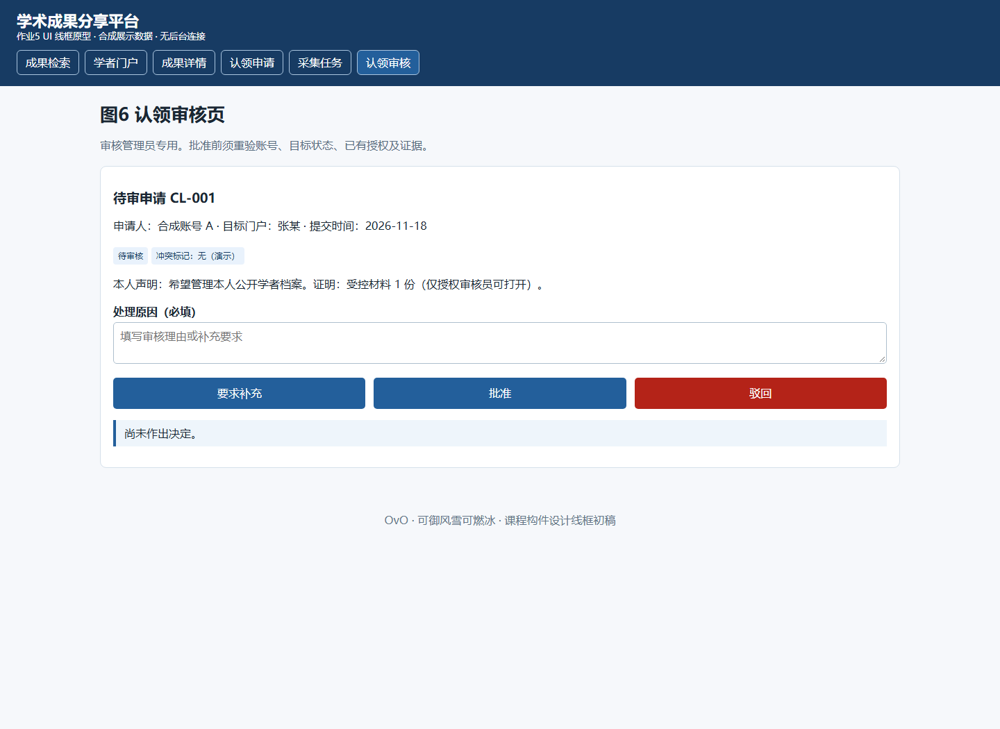

# 学术成果分享平台 UI 设计说明书

03组 可御风雪可燃冰｜作业5构件设计｜V0.1 初稿｜2026-11-18

编写：宋显涵委托 Codex 辅助起草，尚未与其他成员的作业5成果比对；两小组成员、具体分工与签认待填写。本文定义六类主页面的布局、导航和交互，与同目录可浏览 HTML 线框原型一致。原型中的姓名、成果与计数均为合成展示数据；按钮只演示状态，不连接后台。

## 1 依据与信息架构

依据 FR01—FR08、FR11、FR14 和门户认领用例。访客导航为“成果检索—学者门户—成果详情—统计”；登录用户从学者门户进入认领申请；管理员从管理入口进入采集任务及认领审核。公开页面不展示受控证明、内部审核备注和未生效修改。页面路由建议见表1，路径与接口路径分开命名。

|页面|原型锚点 / 路由建议|参与者|关联需求|
|---|---|---|---|
|成果检索页|`#search` / `/search`|访客|FR01|
|学者门户页|`#scholar` / `/scholars/{id}`|访客、门户管理者|FR03、FR06、FR07|
|成果详情页|`#work` / `/works/{id}`|访客|FR02、FR16|
|认领申请页|`#claim` / `/claims/new`|登录用户|FR05|
|采集任务管理页|`#tasks` / `/admin/collection-tasks`|管理员|FR08、FR14|
|认领审核页|`#review` / `/admin/claims`|审核管理员|FR05、FR14|

## 2 页面线框与交互

图1至图6可在 `05-UI原型-可御风雪可燃冰/index.html` 浏览，源文件为 HTML/CSS/JS，离线可打开。表2逐页说明主要区块、关键状态和错误反馈。

|图号与页面|布局与主要组件|交互与异常|
|---|---|---|
|图1 成果检索|顶部导航、范围切换、关键词框、类型/年份/领域/机构筛选、排序、结果列表、分页|条件取交集；切页保留条件；无结果、非法年份、检索故障分别提示；结果进详情或门户|
|图2 学者门户|学者身份与公开机构、认领状态、简介、领域、分类成果列表、分页|未认领仍公开；自动关联与本人确认分标；有门户权限者出现编辑入口，普通访客不出现|
|图3 成果详情|标题、类型、状态、专属字段、参与者、来源、版本、更新时间|缺失标“未知”；仅可公开来源可见；原站链接仅在有合法地址时出现|
|图4 认领申请|目标学者摘要、本人声明、证明上传、校验提示、提交按钮、状态与结果|须登录；材料不合格不提交；已存在审核中申请提示；提交后仅本人可查详情|
|图5 采集任务管理|获准来源选择、任务参数、任务列表、状态、检查点与动作|启动/停止/重试只在许可状态显示；未知总量不显示虚假百分比；失败原因与重试入口可见|
|图6 认领审核|待审队列、申请摘要、冲突标记、受控证明入口、补充/通过/驳回|决定必须填写原因；批准前重验目标与授权冲突；无权限者不能读取证明|

下列图1—图6是同版离线原型的桌面端截图，源文件位于 `05-UI原型-可御风雪可燃冰/index.html`；可以在浏览器中操作导航与演示控件。

图1 成果检索页。

图2 学者门户页。

图3 成果详情页。

图4 认领申请页。

图5 采集任务管理页。

图6 认领审核页。

### 2.1 检索过滤与分页

用户先选“成果”或“学者”，再输入关键词。成果范围显示类型、年份、领域、机构、数据性质；选择父领域包含下级。每次条件变化重置至第1页；页面 URL 保存非敏感查询条件，返回详情后可恢复。排序选项为相关度、时间；分页按服务端游标或受限页码呈现，始终显示当前范围与总量口径。请求失败显示“检索暂不可用”和重试，不显示“没有结果”。无结果时保留筛选器并提供清除入口。

### 2.2 认领提交与审核反馈

申请人从目标门户进入申请页，登录后确认本人声明并上传可核验证明。前端校验类型、大小、数量和必填项，后端重复校验。提交成功展示申请编号和 `待审核`；补充要求展示给申请人，补交后回到待审核。审核员可标记补充、批准或驳回；已有管理人冲突、证据不足或版本变化时不能直接批准。批准后才开放该门户的管理能力；驳回显示可公开给申请人的理由，不暴露内部敏感说明。

## 3 视觉与可用性规范

视觉基调为深蓝 `#173B63`、强调蓝 `#235F9B`、成功绿 `#16764A`、警示橙 `#9A5B00`、错误红 `#B42318`，背景 `#F6F8FB`，正文 `#1B2733`；状态不能只靠颜色区分，必须有文字。正文优先系统中文无衬线字体，14—16 px；标题24 px；控件最小点击区域 40×40 px。布局采用最大宽度 1200 px 的响应式网格，窄屏筛选器折叠为抽屉。表单有可见标签、必填提示和字段级错误；焦点可见，键盘可遍历，动态反馈使用可感知文本。原型以桌面端为主要审阅视口，同时可在窄屏浏览。

## 4 页面、数据与接口对应

|页面|主要 API|数据库事实/投影|
|---|---|
|成果检索|`GET /api/v1/search/works`|CSS 候选 + RDS `work`/`work_scholar` 复核|
|学者门户|`GET /api/v1/scholars/{scholarId}`|`scholar`、`work_scholar`、`portal_grant`|
|成果详情|`GET /api/v1/works/{workId}`|`work`、`source_record`、`work_scholar`|
|认领申请|`POST /api/v1/claims`、`GET /api/v1/claims/{claimId}`|`claim_application`、OBS 受控证明|
|采集任务管理|`POST /api/v1/admin/collection-tasks`、状态与动作接口|`data_source`、`collection_task`|
|认领审核|`GET /api/v1/admin/claims`、`POST /api/v1/admin/claims/{claimId}/decision`|`claim_application`、`portal_grant`、`audit_log`|

## 5 验证与待定事项

检查六页离线可打开、导航可切换、检索筛选和无结果可演示、认领与审核反馈状态可演示；再与 SRS 的权限和状态图逐项核对。原型是线框稿，尚未开展真实用户可用性测试，也不表示接口已实现。两小组各自的 UI 工具、模型、方案差异与人工评审结论需在过程记录中据实补录，不能根据本原型推断已完成交叉评审。
